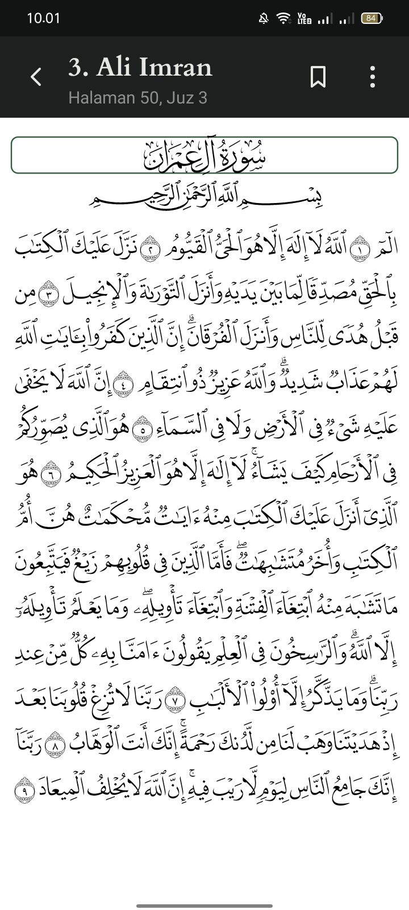
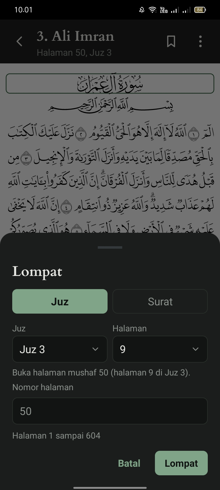
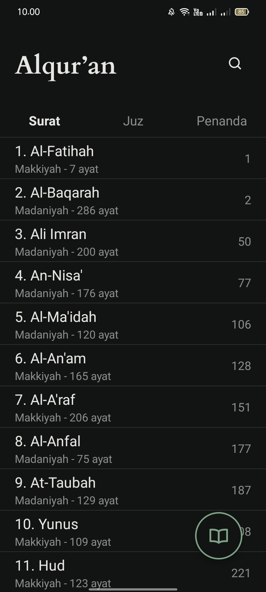
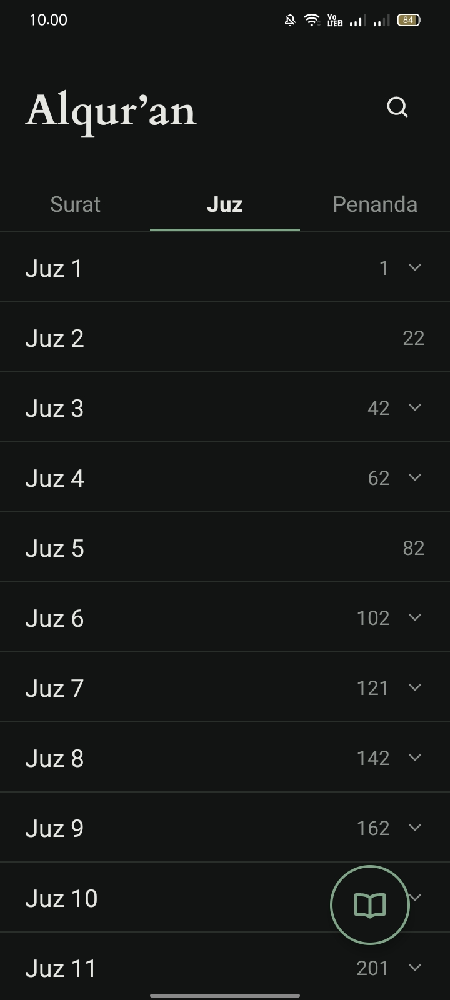
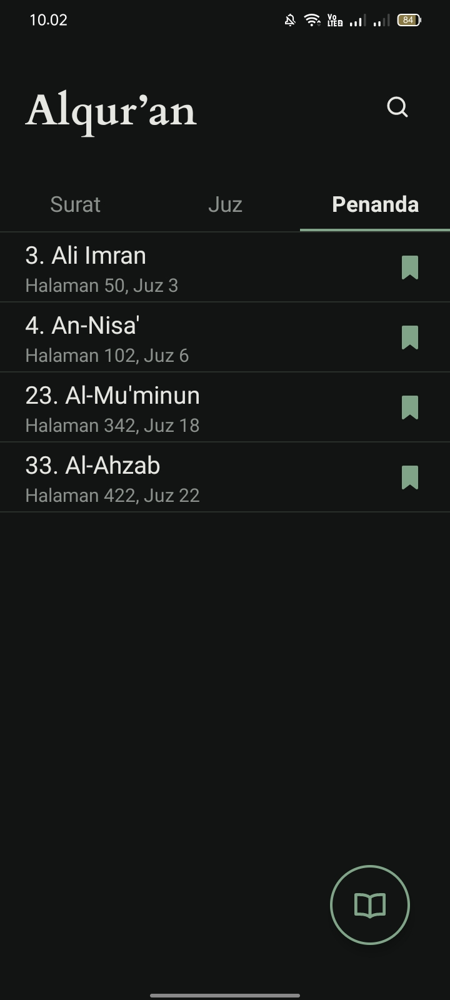

<div align="center">

# Alqur’an

**Pembaca Mushaf Madinah untuk Android — ringan, offline, dan membaca data langsung dari kartu SD.**

[](https://github.com/USERNAME/REPO/actions/workflows/build.yml)








</div>

---

## Tentang

Alqur’an menampilkan 604 halaman Mushaf Madinah dengan tata letak baris per baris yang sama seperti mushaf cetak, memakai font QCF4. Aplikasi ini dibuat untuk membaca dan murajaah dengan nyaman, tanpa internet dan tanpa iklan.

## Fitur

- 📖 **Mushaf Madinah 604 halaman**, digambar per baris dengan font QCF4
- 🗂️ **Daftar Surat, Juz, dan Penanda** dalam satu layar, dengan animasi buka-tutup bergaya gulungan
- 🔎 **Pencarian** surat, juz, halaman, dan ayat
- 🧭 **Lompat cepat** ke halaman, surat, atau ayat; ayat tujuan langsung disorot
- 🔖 **Penanda** halaman dan **halaman terakhir dibaca**
- 🌙 **Mode malam**
- 💾 **Data dari folder pilihanmu**, termasuk kartu SD (lewat Storage Access Framework, izin diingat)

## Persiapan data

Aplikasi ini **tidak menyertakan** data Quran. Kamu perlu menyiapkannya sendiri:

1. Unduh paket **quran-qcf4** (berisi folder `pages` dan `fonts`).
2. Simpan di penyimpanan HP atau kartu SD.
3. Buka aplikasi, lalu pilih folder yang berisi `pages` dan `fonts` (folder di atasnya juga boleh).

Cukup sekali, izin folder akan diingat.

## Instal

Unduh APK terbaru di halaman [**Releases**](https://github.com/USERNAME/REPO/releases), lalu instal di HP.
Butuh Android 8.0 (API 26) ke atas.

## Build dari source

```bash
git clone https://github.com/USERNAME/REPO.git
cd REPO
./gradlew assembleDebug
```

APK ada di `app/build/outputs/apk/debug/`. Butuh JDK 17.

## Struktur proyek

```
app/src/main/java/com/sabilu/alquran/
├── WelcomeActivity.kt     # pilih folder data
├── MainActivity.kt        # daftar surat, juz, penanda
├── ReaderActivity.kt      # pembaca mushaf (ViewPager2)
├── MushafPageView.kt      # menggambar satu halaman
├── LompatDialog.kt        # lompat ke halaman/surat/ayat
├── SearchActivity.kt      # pencarian
├── QuranFiles.kt          # membaca data dari folder pilihan
└── Gulungan.kt            # animasi buka-tutup daftar
```

## Teknologi

Kotlin · AndroidX (AppCompat, RecyclerView, ViewPager2, DocumentFile) · Custom `View` + `Canvas` · GitHub Actions

## Lisensi & kredit

- Kode aplikasi: [MIT](LICENSE)
- Font **Cardo** dilisensikan di bawah SIL Open Font License
- Data dan font **QCF4** milik pemegang haknya masing-masing dan tidak disertakan di repositori ini

## Kontribusi

Saran dan perbaikan sangat diterima. Buka [Issue](https://github.com/USERNAME/REPO/issues) atau kirim Pull Request.
